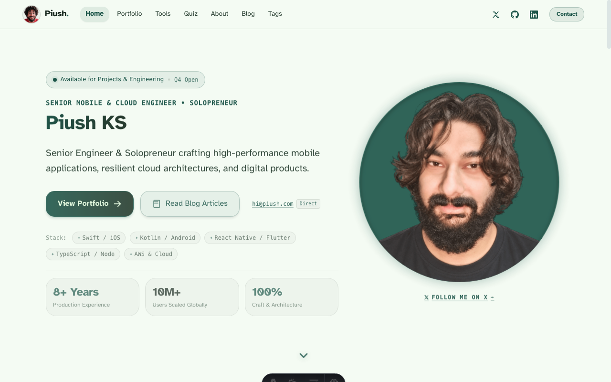
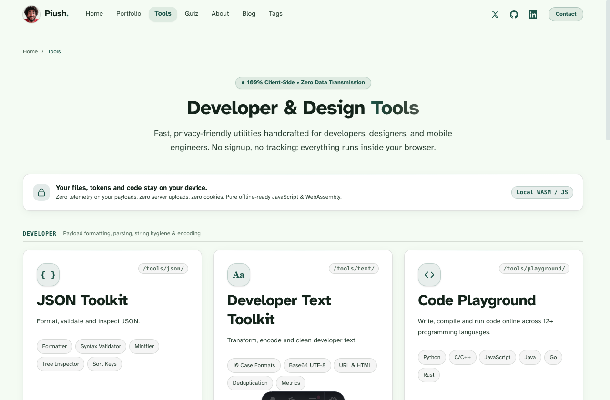
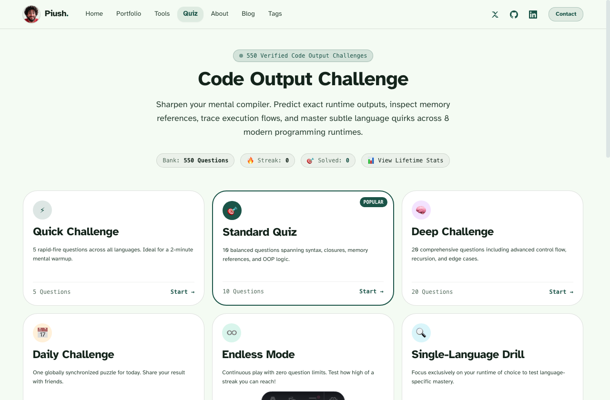
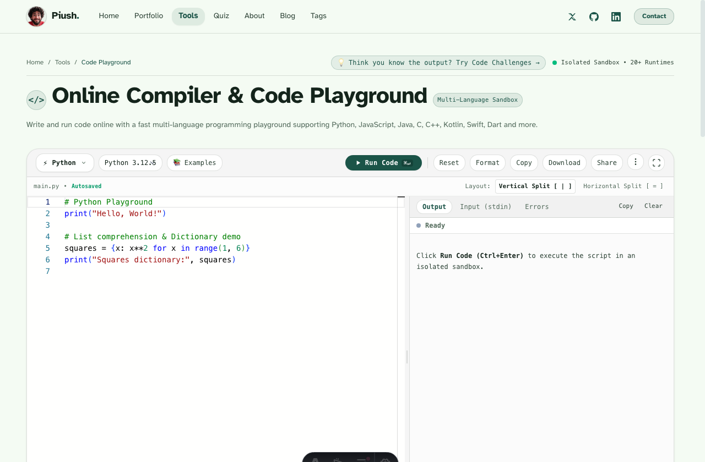
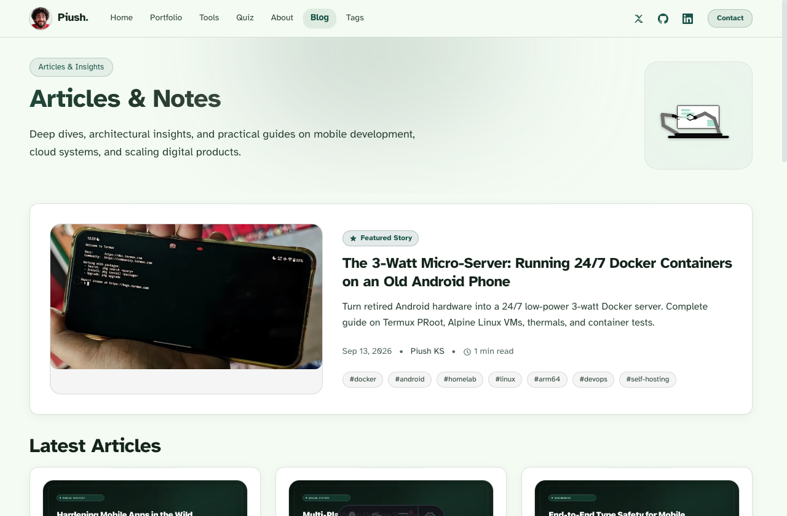
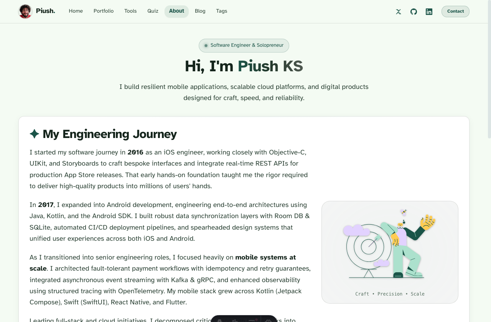

# Piush KS – Mobile Architect, Full-Stack Engineer & Solopreneur

[](https://piush.com/)
[](https://astro.build/)
[](https://tailwindcss.com/)
[](https://www.typescriptlang.org/)
[](https://opensource.org/licenses/MIT)

The official source code for [**piush.com**](https://piush.com/) – a lightning-fast, production-hardened developer platform, engineering blog, and privacy-first web utilities suite built by **Piush KS**.

Built with **Astro 5 SSG**, **Tailwind CSS v4**, **TypeScript**, and **Starwind UI design tokens**, the site achieves near-instant page loads, 100/100 Core Web Vitals, and strict SEO compliance with zero client-side tracking or telemetry.

---

## 📸 Website Screens & Visual Showcase

### 🏠 Home & Engineering Portfolio
*Modern personal brand, interactive experience metrics, live skills carousel, and featured mobile/cloud projects.*



---

### 🛠️ Developer & Design Tools Hub
*100% client-side, zero-telemetry suite of utilities for mobile engineers, frontend developers, and UI designers.*



---

### ⚡ Code Output Challenge (550+ Questions)
*Interactive programming output challenge supporting 9 languages, multiple challenge modes, streak tracking, and lifetime stats.*



---

### 💻 Multi-Language Online Compiler & Playground
*Instant browser-based code playground supporting Python, JavaScript, Java, C, C++, Kotlin, Swift, Dart, Go, and Rust.*



---

### ✍️ Technical Systems & Architecture Blog
*Deep dives into mobile engineering, memory profiling, system architecture, render pipelines, and zero-bundle frontend patterns.*



---

### 👤 About Piush KS & Engineering Journey
*Interactive timeline documenting an 8-year evolution across iOS, Android, cross-platform apps, and distributed cloud systems.*



---

## 🙋‍♂️ About Piush KS

I am a **Senior Mobile Architect, Full-Stack Engineer, and Solopreneur** with **8+ years of production experience** engineering resilient client applications and distributed systems scaled to **over 10M+ users globally**.

### 🛠️ Core Stack & Expertise:
- **Mobile Engineering**: Swift (iOS / UIKit / SwiftUI), Kotlin (Android / Jetpack Compose), Flutter, React Native, Cross-platform architecture.
- **Client Storage & Sync**: Room DB, SQLite, MMKV, Realm, Offline-First Sync & Conflict Resolution.
- **Backend & Cloud Systems**: Node.js, TypeScript, PostgreSQL, Redis, Docker, Kafka, gRPC, AWS, RESTful & GraphQL APIs.
- **Frontend & Web**: Astro, React, Tailwind CSS, WebAssembly, Starwind UI design systems.
- **Engineering Principles**: High Craft & Speed • Resilient Architecture • Builder Mindset.

### 📬 Connect & Contact
- **Website**: [https://piush.com/](https://piush.com/)
- **Email**: [hi@piush.com](mailto:hi@piush.com)
- **GitHub**: [@PiushKS](https://github.com/PiushKS)
- **LinkedIn**: [Piush KS](https://linkedin.com/in/piush-ks)
- **X (Twitter)**: [@piush_ks](https://x.com/piush_ks)

---

## ✨ Features & Architecture

### 1. 🧰 100% Client-Side Developer Tools (`/tools/`)
All developer tools execute purely inside the browser using JavaScript and WebAssembly. **Zero data leaves the user's device.**
- **JSON Toolkit (`/tools/json/`)**: Format, minify, sort keys, inspect tree nodes, and validate JSON syntax with instant error highlighting.
- **Developer Text Toolkit (`/tools/text/`)**: Convert 10 case formats (camelCase, snake_case, PascalCase, kebab-case, CONSTANT_CASE, etc.), encode/decode Base64 UTF-8, URL encode, HTML entity escape, clean whitespace, and calculate character metrics.
- **Code Playground & Compiler (`/tools/playground/`)**: Multi-language code editor and execution sandbox with templates for Python, JS, C, C++, Java, Kotlin, Swift, Go, and Rust.
- **SVG Studio (`/tools/svg/`)**: Real-time SVG editor, SVG path optimizer/minifier, and high-DPI PNG exporter.
- **UI Design Studio (`/tools/ui/`)**: Visual generator for CSS glassmorphism, neumorphism, complex multi-layer box shadows, and gradient backgrounds with exportable CSS tokens.
- **Color Space Studio (`/tools/colors/`)**: Advanced color conversions across OKLCH, HEX, RGB, and HSL with contrast checking and palette generation.

### 2. 🎯 Code Output Challenge Quiz (`/quiz/`)
- **550+ Hand-Curated Questions**: Spanning C, C++, Java, Python, JavaScript, Kotlin, Swift, Dart, and Go.
- **Diverse Game Modes**: Quick Challenge (5 questions), Standard Quiz (10 questions), Deep Challenge (20 questions), Daily Challenge, Endless Mode, and Single-Language Drills.
- **Client-Side Engine**: Randomized question generation, streak tracking via localStorage, instantaneous feedback explanations, and confetti animations.

### 3. 📚 Technical Systems Engineering Blog (`/blog/`)
- **16 Deep-Dive Architecture Articles**: Real-world benchmarks, memory leak prevention in Node.js, OKLCH color spaces, Flutter render pipeline internals, React Native new architecture benchmarks, SQLite vs Realm vs MMKV, etc.
- **Content Collections Schema**: Strict frontmatter validation using Zod with `seoTitle`, `pubDate`, `tags`, `category`, and `readingTime`.
- **Taxonomy & Discovery**: Multi-tag filtering (`/tags/`, `/blog/tag/[tag]/`), paginated listing (`/blog/page/[page]/`), and instantaneous client-side search via Fuse.js.
- **Full RSS Feed**: Global RSS feed (`/rss.xml`) with autodiscovery tags on every page.

### 4. 🚀 Top-Tier SEO & Performance Architecture
- **Canonical Trailing Slash Routing**: Strict trailing slash enforcement (`trailingSlash: 'always'`) eliminating crawl duplicates across all internal links, sitemaps, and Apache rewrites.
- **Structured Data (JSON-LD)**: Rich schema markup including `ProfilePage`, `WebApplication`, `BreadcrumbList`, and `BlogPosting`.
- **Automated Quality Checks**: Dedicated test suites `npm run validate:seo` (checks sitemaps, meta tags, and broken links across 74 static pages) and `npm run validate:quiz` (verifies all 550 quiz entries).
- **Core Web Vitals**: Lossless asset compression, font preloading, zero layout shifts, and inline SVG rendering.

---

## 🛠️ Tech Stack

| Layer | Technologies |
| :--- | :--- |
| **Framework** | [Astro 5](https://astro.build/) (Static Site Generation / SSG) |
| **Styling** | [Tailwind CSS v4](https://tailwindcss.com/), Starwind UI Design Tokens |
| **Language** | [TypeScript](https://www.typescriptlang.org/) |
| **Content** | Markdown & MDX with Content Collections (`astro:content`) |
| **Icons & Media** | Tabler Icons, Custom Handcrafted SVGs, Lottie Web Animations |
| **Search & Logic** | Fuse.js (Client-side indexing), Canvas Confetti |
| **Image Processing**| Sharp 0.35.5 (Lossless compression & AVIF/WebP generation) |
| **Hosting** | Apache / LiteSpeed (Hostinger) with custom `.htaccess` optimization |

---

## 📁 Project Structure

```text
piush.com/
├── public/
│   ├── .htaccess             # Production Apache rewrite, caching & security rules
│   ├── robots.txt            # Crawl instructions pointing to canonical sitemap
│   ├── data/quiz/            # 550+ verified coding questions in JSON
│   ├── screenshots/          # High-resolution website screenshot showcase
│   └── images/               # High-efficiency avatars and portraits
├── src/
│   ├── assets/               # Raw SVG logos, UI icons, and illustrations
│   ├── components/
│   │   ├── quiz/             # Code challenge game boards, counters, results
│   │   ├── sections/         # Header, Hero, Skills, Portfolio, Tools, Footer
│   │   └── ui/               # Reusable buttons, badges, modals, search, cards
│   ├── content/
│   │   └── blog/             # 16 in-depth systems engineering markdown posts
│   ├── data/                 # Centralized site data (skills, projects, timeline)
│   ├── layouts/              # BaseHead, BlogPost, Root Layout templates
│   ├── pages/
│   │   ├── index.astro       # Homepage
│   │   ├── about.astro       # Engineering story & career timeline
│   │   ├── portfolio.astro   # Projects & client work
│   │   ├── quiz.astro        # Code Output Challenge
│   │   ├── tags.astro        # Topics directory
│   │   ├── tools/            # JSON, Text, SVG, UI, Colors, Playground tools
│   │   └── blog/             # Blog archives, paginated views, and post routes
│   └── styles/               # Tailwind base, dark mode tokens, typography utilities
├── scripts/
│   ├── build-quiz-database.mjs # Quiz bundle aggregator
│   ├── validate-quiz.mjs       # Question schema & integrity validator
│   └── validate-seo.mjs        # Production SEO & structured data linter
└── astro.config.mjs          # Astro build & integration configuration
```

---

## 🚀 Quick Start & Development

### 1. Prerequisites
- **Node.js**: `v20.0.0` or higher
- **Package Manager**: `npm`

### 2. Clone & Install
```bash
# Clone the repository
git clone https://github.com/PiushKS/piush.com.git
cd piush.com

# Install dependencies
npm install
```

### 3. Start Development Server
```bash
npm run dev
# The local development server will start at http://localhost:4321/
```

### 4. Run Verification Suites
```bash
# Validate all 550 quiz questions
npm run validate:quiz

# Build static production bundle
npm run build

# Validate SEO, sitemaps, links, and schema markup
npm run validate:seo
```

---

## 🌐 Production Deployment

The project compiles to pure static HTML, CSS, JavaScript, and SVG assets in the `dist/` directory.

### Deploying to Hostinger (Apache / LiteSpeed)
1. Run `npm run build` to generate the production `dist/` folder.
2. Upload the contents of `dist/` directly into your server's `public_html/` directory.
3. Ensure the included [`.htaccess`](./public/.htaccess) file is placed in `public_html/` to enable:
   - Canonical trailing slash 301 redirects.
   - Gzip / Deflate compression for text, SVGs, and JSON payloads.
   - 1-year browser cache-control headers for static fonts, styles, scripts, and images.
   - Strict security headers (`X-Content-Type-Options`, `X-Frame-Options`, `Referrer-Policy`).

### Deploying to Vercel, Netlify, or Cloudflare Pages
- **Build Command**: `npm run build`
- **Output Directory**: `dist`
- **Node.js Version**: `20.x`

---

## 📄 License

This project is licensed under the [MIT License](./LICENSE).

---

<p align="center">
  Crafted with care by <a href="https://piush.com/"><strong>Piush KS</strong></a>.
</p>
