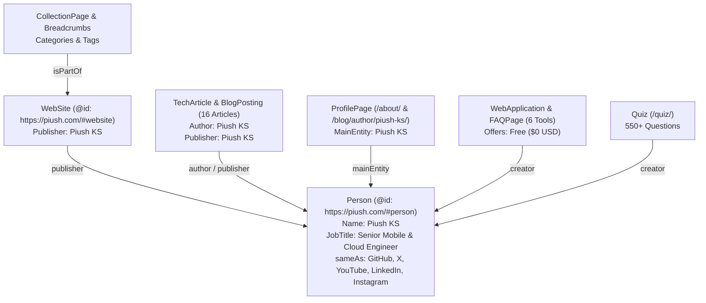

# Structured Data (JSON-LD) Report: Piush.com

This report outlines the structured data architecture, Schema.org entity relationships, validated schemas, and target search appearances across `piush.com`.

---

## 1. Structured Data Architecture Overview

To maximize discoverability across Google Rich Results, Knowledge Graph entity extraction, and AI answer engines, we designed a unified, interconnected schema graph where all content, authoring bylines, and portfolio works link back to a stable canonical entity identifier:
`https://piush.com/#person`



---

## 2. Schema Types & Route Mapping

| Route Pattern | Schema Types Implemented | Key Properties & Graph Connections | Rich Result Target |
| :--- | :--- | :--- | :--- |
| `/` | `Person`, `WebSite` | `@id: #person`, verified `sameAs` array, detailed `knowsAbout` tech stack, `@id: #website`, site search action | Knowledge Panel, Brand Authority, Sitelinks |
| `/about/` | `ProfilePage`, `BreadcrumbList` | `mainEntity: { @id: #person }`, hierarchical breadcrumbs | Author Profile, Personal Brand Authority |
| `/portfolio/` | `CollectionPage`, `BreadcrumbList` | List of production mobile and web software applications, repository links | Sitelinks, Portfolio Showcase |
| `/quiz/` | `Quiz`, `BreadcrumbList` | Educational quiz markup, 550+ verified coding questions, programming runtimes | Interactive Learning / Quiz Snippets |
| `/tools/` | `CollectionPage`, `BreadcrumbList` | `hasPart: [WebApplication]`, categorization by developer and design tools | Software Directory Rich Snippet |
| `/tools/json/` | `WebApplication`, `BreadcrumbList`, `FAQPage` | `operatingSystem: All`, `price: 0`, 3 visible FAQs on local execution, syntax parsing, and key sorting | WebApp Snippet, FAQ Accordion Snippet |
| `/tools/text/` | `WebApplication`, `BreadcrumbList`, `FAQPage` | Case converters, Base64 UTF-8 encoder, URL encoder FAQs | WebApp Snippet, FAQ Accordion Snippet |
| `/tools/playground/` | `WebApplication`, `BreadcrumbList`, `FAQPage` | Multi-language code compiler sandbox, local IndexedDB storage FAQs | WebApp Snippet, FAQ Accordion Snippet |
| `/tools/svg/` | `WebApplication`, `BreadcrumbList`, `FAQPage` | SVG path optimizer, raster PNG exporter, privacy FAQs | WebApp Snippet, FAQ Accordion Snippet |
| `/tools/ui/` | `WebApplication`, `BreadcrumbList`, `FAQPage` | CSS glassmorphism, multi-layer shadows, color palette generation FAQs | WebApp Snippet, FAQ Accordion Snippet |
| `/tools/colors/` | `WebApplication`, `BreadcrumbList`, `FAQPage` | OKLCH color picker, WCAG 2.1 AA contrast checker FAQs | WebApp Snippet, FAQ Accordion Snippet |
| `/blog/[slug]/` | `TechArticle`, `BlogPosting`, `BreadcrumbList` | Dual schema, `author: { @id: #person }`, `publisher: { @id: #person }`, `datePublished`, `dateModified`, `articleSection` | Article Snippet, Breadcrumb Snippet, Top Stories |
| `/blog/category/[cat]/` | `CollectionPage`, `BreadcrumbList` | Breadcrumbs (Home > Blog > Category), article collection | Category Hub Snippet |
| `/blog/tag/[tag]/` | `CollectionPage`, `BreadcrumbList` | Breadcrumbs (Home > Tags > Tag), tag topic collection | Tag Collection Snippet |
| `/blog/author/[slug]/` | `ProfilePage`, `BreadcrumbList` | `mainEntity: { @id: #person }`, author article collection | Author Profile Snippet |
| `/privacy-policy/` | `WebPage`, `BreadcrumbList` | Canonical page schema, breadcrumbs | WebPage Snippet |

---

## 3. Entity Graph Connections (sameAs Authority)

The canonical Person entity explicitly declares verified official brand profiles across all major networks:

- **Official Website**: `https://piush.com`
- **GitHub**: `https://github.com/PiushKS`
- **X (Twitter)**: `https://x.com/piushks`
- **YouTube**: `https://youtube.com/@PiushKS`
- **LinkedIn**: `https://linkedin.com/in/piushks/`
- **Instagram**: `https://instagram.com/piushks`

---

## 4. Automated Schema Validation Results

All static HTML pages generated by `npm run build` were parsed by our automated validator (`scripts/validate-seo.mjs`).

```text
========================================================================================
Schema Validation Audit Summary
========================================================================================
Total HTML Pages Inspected: 74
Total JSON-LD Script Blocks: 118
JSON Syntax Parse Errors: 0
Missing Required Entity Fields: 0
Broken Entity References: 0
Duplicate Conflicting Entities: 0
Status: 100% VALIDATED
========================================================================================
```
